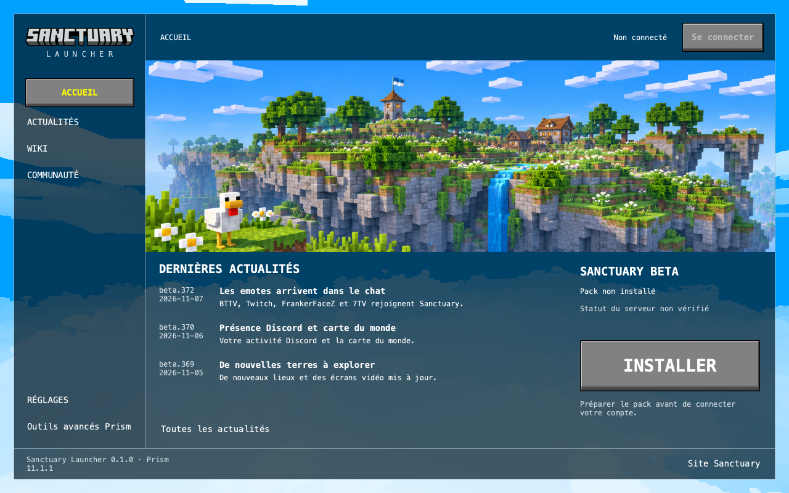

# Sanctuary Launcher

Fork natif de **Prism Launcher 11.1.1**, avec un accueil Qt dédié à Sanctuary.
Le premier lot **0.1.0 de développement** compile localement sur macOS Apple
Silicon. Il ne constitue pas encore une distribution pour les joueurs.

## Premier lot disponible

- Accueil FR/EN conforme à la [référence approuvée](docs/design/README.md) :
  paysage, navigation, actualités et zone Installer/Jouer.
- Trois actualités embarquées du site, avec leurs liens de lecture. Leur
  récupération automatique reste à ajouter.
- Bouton Installer ouvrant l'import Prism avec l'archive officielle Sanctuary
  préremplie. Il reste un dialogue d'import, sans nouvel installateur automatique.
- Réglages et outils avancés Prism conservés ; retour à l'accueil par
  l'action Sanctuary ou `Alt+Home` dans les outils avancés.
- Identité et dossier de données Sanctuary distincts de Prism ; aucune
  reprise automatique des comptes et instances d'un autre launcher.
- [Application Microsoft Sanctuary créée](docs/microsoft.md), avec son propre
  Client ID et les flux clients publics activés. Son accès Minecraft reste
  à demander et son raccordement au binaire reste à réaliser ; la connexion
  et le bouton Jouer restent désactivés dans ce premier lot.



L'image ci-dessus est un rendu du widget Qt pendant les tests, et non une
capture d'un essai complet du jeu. Le statut serveur reste explicitement
non vérifié. Les actualités embarquées ne constituent pas un flux en direct.

## Développement

Lire le [guide de développement et la recette](docs/developpement.md), puis
le [cahier des charges](docs/cahier-des-charges.md). Construction locale :

```sh
git submodule update --init --recursive
./scripts/build-sanctuary-macos.sh
```

Le script requiert les dépendances décrites dans le guide. Le bundle local
est produit dans `build/native/sanctuary-launcher.app` ; il dépend de Homebrew,
n'est pas signé/notarisé et cible macOS 26. Windows, Linux, macOS antérieur et
les parcours réels d'installation/lancement ne sont pas validés par ce lot.

Les **22 suites CTest** passent, dont les contrôles propres à l'accueil.
L'application démarre avec un dossier Sanctuary neuf. Le contrôle automatique
de la fenêtre native macOS a expiré : les interactions testées sont celles du
widget Qt, pas une recette complète à l'écran.

## Étapes suivantes

L'installation/réparation sans import manuel, le flux d'actualités du site,
les réglages initiaux shaders/Sound Physics sur Vulkan, l'authentification
Microsoft, la connexion directe au serveur et les paquets distribuables
restent à réaliser. Microsoft peut attendre les travaux d'interface et
d'installation ; il sera nécessaire pour les vrais essais de compte et
d'accès au serveur. La [base existante packwiz](existing/launcher/packwiz/)
et ses [instructions Prism](existing/docs/beta-download.md) sont conservées.

## Origine et distribution

L'historique de ce dépôt et celui de Prism sont conservés, avec les licences
[GPL-3.0-only](LICENSE), [COPYING](COPYING.md) et le
[README amont](docs/upstream/Prism-README.md). Le tag de référence est
`upstream/prism/11.1.1`, commit `7d2d3c1ec6fcf8255ebacd02d9f792688575dfb4`.
Sanctuary Launcher est un fork indépendant, sans approbation de l'équipe Prism.

Les identifiants Microsoft, CurseForge et Imgur amont et les canaux de mise à
jour Prism sont désactivés. Les métadonnées Minecraft et traductions publiques
Prism sont encore utilisées. Les sources correspondantes et les modalités de
distribution seront préparées avant livraison de binaires. Les dépôts restent
privés. Les anciens travaux Release sont conservés sous
[`archive/release-foundation-20261108`](https://github.com/sanctuary-minecraft/sanctuary-launcher/tree/archive/release-foundation-20261108).
