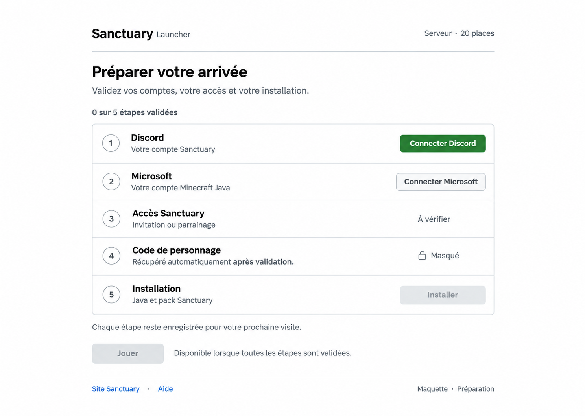

# Direction visuelle de Sanctuary Launcher

La **DA blanche, sobre et centrée, inspirée de GitHub**, est retenue par Koka
le **8 novembre 2026**. Le parcours de référence est désormais **Mes comptes →
Mon accès → Mon jeu**, avec un code de personnage SGA facultatif. Le
[cahier des charges 0.3](../cahier-des-charges.md) définit le comportement cible.

## Principes retenus

- Fond blanc uni, sans paysage ni textures ; colonne de contenu centrée.
- Texte sombre lisible sans empattement, espaces réguliers et traits gris fins.
- Commandes compactes ; vert pour les validations, ambre pour l'attente, liens
  identifiables et statuts compréhensibles sans dépendre uniquement de la couleur.
- Connexions Discord et Microsoft dans Mes comptes ; candidature, parrainage et
  marqueur historique bêta dans Mon accès ; installation, Jouer, mods et shaders
  dans Mon jeu.
- Code SGA disponible sous Afficher mon code, avec Copier, après admission :
  aucune case obligatoire à cocher ni copie à effectuer pour jouer normalement.
- Retour quotidien centré sur Jouer, avec reprise des comptes et du dossier.

## Maquettes de direction conservées

Ces trois images sont les états d'une même exploration blanche, pas des
captures du launcher implémenté. **Elles précèdent la réflexion finale** : les
cinq lignes de validation et l'installation bloquée pendant l'attente qui y
figurent ne sont plus le contrat du parcours. La révision 0.3 retient trois
blocs, une installation possible pendant l'attente et le code en second plan.
Une nouvelle composition en trois blocs reste à dessiner avant son intégration.

| Image | Usage |
| --- | --- |
| [Préparation](blanc-2026-11-08/preparation.png) | Direction claire, centrage, alignements et commandes |
| [Candidature en attente](blanc-2026-11-08/candidature-en-attente.png) | Statuts lisibles, attente distincte d'une erreur de compte |
| [Prêt à jouer](blanc-2026-11-08/pret-a-jouer.png) | État validé, exemple SGA fictif, accès Jouer/Mods/Shaders/Réglages |

Les fichiers sont copiés sans retouche ni redimensionnement. Dimensions,
tailles et SHA-256 sont consignés dans
[le registre de provenance](blanc-2026-11-08/provenance.json). Génération Imagegen
le 8 novembre 2026, avec les composants GitHub/Primer pour leur sobriété et
une planche SGA pour les glyphes. Le nom Sanctuary est rendu en texte simple
pour cette exploration. Aucun code personnel réel ni statut de compte réel
n'est représenté.

## Archive et application existante

La [première maquette à paysage](archive-accueil-2026-11-08.md) et son PNG
original restent conservés avec leur empreinte. Cette direction historique
ne définit plus la cible visuelle. L'[accueil Qt déjà compilé](../implementation/accueil-qt-fr.png)
l'utilise encore ; cette révision documentaire ne modifie pas l'application.
Les ressources d'origine et leur provenance restent dans [assets.md](assets.md).
