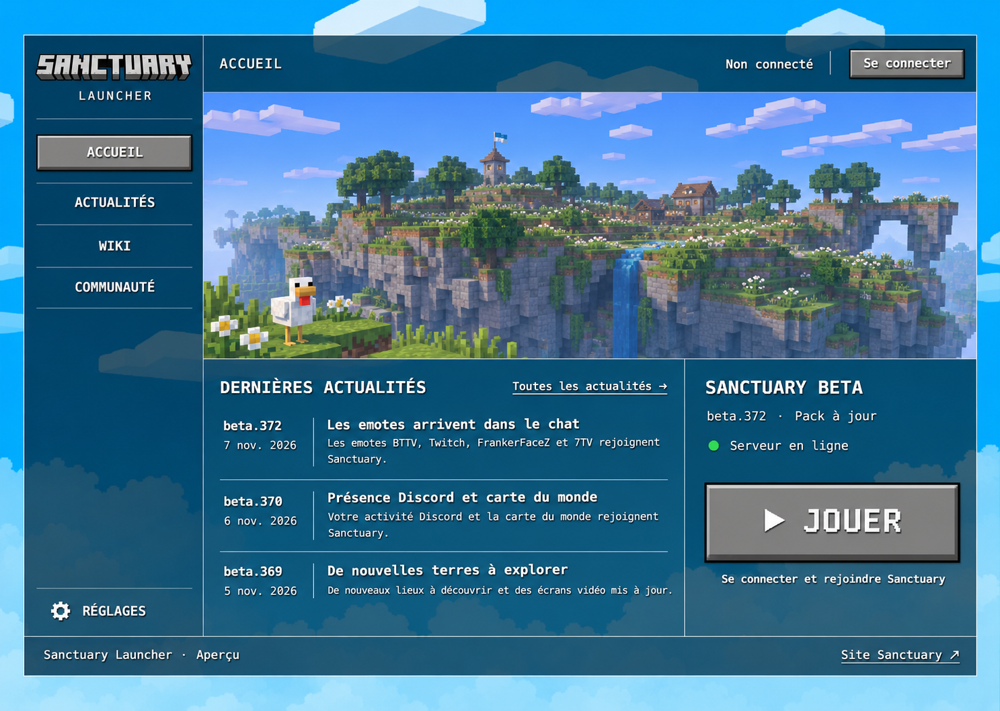

# Référence visuelle de Sanctuary Launcher

Cette maquette d'accueil a été **validée par Koka le 8 novembre 2026**. Elle
sert de référence pour le futur fork de Prism. Les autres écrans restent à
concevoir selon le [cahier des charges](../cahier-des-charges.md).

## Fichier conservé

| Propriété | Valeur |
| --- | --- |
| Fichier | `accueil-sanctuary-reference-2026-11-08.png` |
| Dimensions réelles | 1487 × 1058 pixels |
| Taille | 1 799 686 octets |
| SHA-256 | `363d675a1e54944c6b4b941ff15ca671a0c43d094c96e2d04579201cb3f67f83` |
| Création | Imagegen, le 8 novembre 2026 |
| État | Maquette statique approuvée, original sans retouche ni redimensionnement |

La composition visait un écran de bureau de 1440 × 1024 ; les dimensions
ci-dessus sont celles du PNG effectivement généré et validé. Le paysage est
une illustration d'intention, pas une capture du monde en production. Les
actualités reprennent les publications 372, 370 et 369 du site. Le statut
serveur, le pack installé et l'état du compte sont des états d'exemple.

## Principes à conserver

- Ciel Minecraft derrière l'interface ; panneaux sombres transparents,
  traits fins, géométrie rectangulaire et texte blanc lisible.
- Mot-symbole Sanctuary existant, typographie monospace et boutons gris en
  relief inspirés du site.
- Navigation à gauche ; paysage en haut ; actualités en liste en dessous ;
  zone Jouer à droite avec version du pack et état serveur.
- Compte en haut à droite, réglages en bas à gauche et lien vers le site.

La validation porte sur la hiérarchie et la direction visuelle. Les versions,
actualités et statuts devront venir des données réelles. Le mot « Aperçu » du
pied de page sera remplacé par la vraie version du launcher lorsqu'elle existera.
Les traductions, focus clavier et états d'erreur doivent rester lisibles.

## Références de création

La génération a utilisé la capture de l'[accueil Sanctuary](https://sanctuary-minecraft.net/)
observé le 8 novembre, le [mot-symbole existant](https://github.com/sanctuary-minecraft/sanctuary-web/blob/main/public/images/minecraft.png)
et une [image de prairie du projet](https://github.com/sanctuary-minecraft/sanctuary-web/blob/main/public/images/carousel/sanctuary-meadow.png).
Les [styles du site](https://github.com/sanctuary-minecraft/sanctuary-web/blob/main/public/css/sanctuary.css)
précisent les surfaces, traits et polices à reprendre.

L'intention de génération était un accueil unique en français, fidèle au site,
avec les trois dernières actualités, une grande zone Jouer et un compte non
connecté. Cette image n'est pas un prototype interactif. Toute révision future
recevra un nouveau nom et sa propre validation, sans écraser cet original.
