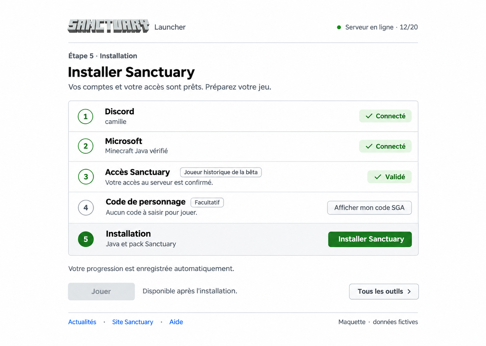

# Direction visuelle de Sanctuary Launcher

Le **8 novembre 2026**, après l'exploration en trois blocs, Koka retient à
nouveau **un seul bloc contenant les étapes 1 à 5**, dans la **DA blanche**.
Le **titre de l'étape en cours** occupe le haut du bloc de préparation. Le mot-symbole du
site, le badge historique, le code SGA facultatif et tous les outils Prism
restent demandés. Le [cahier des charges 0.9](../cahier-des-charges.md) fixe
ce parcours.

## Application native actuelle

Koka demande de travailler sur l'application native, sans nouvelles maquettes.
Le titre **Accueil** reprend les autres pages natives (23 px, graisse 600).
La date et l’heure locales sont placées en dessous, en sous-titre discret,
avec mise à jour automatique. Les trois flux retrouvent des cadres fins et
le fond gris très léger des tableaux natifs (#f6f8fa).

Intendance en haut sans visage, Gazette à gauche et Tableau à droite avec le
visage du skin Minecraft de chaque auteur près du titre. L’intérieur conserve
la présentation Sanctuary : résumés, visages et publications dépliables, sans
nouveau titre de rubrique. Un clic déplie le texte et les images de la Gazette ;
le flux peut défiler. Le header commence au niveau du logo et Jouer reste dans
le footer fixe.

Le premier onglet **Bien démarrer** conserve les cinq étapes, même après
Discord, et garde Microsoft visible en attente de l'autorisation nécessaire.
Cette page et l'accueil partagent la même session et le même pack. Les outils
Prism et Actualités restent dans la navigation de la même fenêtre.
Voir la [recette actuelle](../implementation/accueil-minimal-20261108.md).
Les images suivantes restent des références de recherche historiques.

## Maquette conservée — Installation

Cette image actualise la direction demandée : la ligne 5 est active et le
titre principal est **Installer Sanctuary**, accompagné de **Étape 5 ·
Installation**. Les autres étapes restent visibles dans le même bloc :

1. **Discord** — compte connecté.
2. **Microsoft** — Minecraft Java vérifié.
3. **Accès Sanctuary** — admission confirmée et badge **Joueur historique de la bêta**.
4. **Code de personnage** — mention **Facultatif**, code masqué sous Afficher mon code SGA.
5. **Installation** — action principale Installer Sanctuary.

La ligne 4 ne doit pas devenir une obligation : le joueur peut préparer
son jeu et jouer normalement sans afficher ni recopier son code. Les numéros
indiquent la place dans le parcours, pas cinq validations obligatoires.

**Tous les outils** ouvre la [gestion complète de Prism](../outils-prism.md) :
mods, packs de ressources et de shaders, captures, mondes, serveurs, versions,
réglages, logs et autres pages natives. Les réglages globaux restent accessibles. Le parcours courant expose une
seule instance officielle et ses outils intégrés. Les raccourcis Mods/Shaders/Réglages peuvent
être proposés pour une installation prête ; l'accueil ne limite pas les outils.

Le compte `camille`, le badge, les validations et **12/20** sont fictifs. Ce
compteur représente les connexions simultanées, sans plafond de vingt membres
admis. Aucun téléchargement n'est en cours sur l'image : Installer est une
action à lancer. Jouer reste indisponible tant que le jeu n'est pas prêt.
Cette maquette ne prouve aucune connexion, licence, admission ou installation.

Koka valide cette composition puis demande les
[autres étapes et l'attente d'accès](parcours-cinq-etapes-2026-11-08.md).
Les états d'erreur restent à décliner. Le contrat prévoit l'installation pendant l'attente,
le contrôle serveur de l'admission et la reprise des sessions et préférences.
Le titre suit l'action active : Connecter Discord, Connecter Microsoft, Accès
Sanctuary — En attente, Installer Sanctuary, puis Jouer à Sanctuary lorsque
les prérequis sont remplis. Il ne reste pas figé sur un titre de bienvenue.

## Fichiers et identité

| Fichier | Rôle |
| --- | --- |
| [installation-reference.png](blanc-cinq-etapes-2026-11-08/installation-reference.png) | Référence conservée, 1486 × 1059 pixels |
| [provenance.json](blanc-cinq-etapes-2026-11-08/provenance.json) | Sources, contexte de la demande, dimensions, taille et SHA-256 |
| [prompt.txt](blanc-cinq-etapes-2026-11-08/prompt.txt) | Consigne complète de génération |

Génération par **Imagegen intégré**, le 8 novembre 2026, à partir de la première
maquette blanche de préparation et du mot-symbole original du site. Le PNG
produit est conservé sans retouche de pixels ni redimensionnement. Le format
visé était 1487 × 1058 ; les dimensions ci-dessus sont celles du fichier obtenu.

Le site utilise `public/images/minecraft.png` dans son en-tête de navigation.
Ce fichier original a été fourni à la génération et existe déjà dans le fork
sous [wordmark.png](../../launcher/resources/sanctuary/wordmark.png). Pour
l'application, utiliser ce PNG original de **1024 × 172 pixels**, avec sa
transparence et ses proportions, plutôt que retaper le nom ou découper sa
reproduction dans la maquette. La maquette fixe la composition, pas les pixels
du fichier source.

## Principes retenus

- Fond blanc uni sans paysage ni textures ; colonne centrée et espace régulier.
- Un bloc commun avec séparateurs fins, cinq numéros et une seule action principale.
- Titre et ligne active cohérents, étapes accomplies conservées et reconnexion ciblée.
- Mot-symbole du site dans l'en-tête ; consignes et commandes en texte sans empattement lisible.
- Vert pour les validations, ambre pour l'attente ; statuts lisibles sans la couleur seule.
- Code SGA facultatif et masqué par défaut, sans prérequis de copie pour Jouer.
- Accès complet aux outils de Prism et retour à l'accueil Sanctuary.

## Versions précédentes conservées

La recherche en trois blocs a été validée avant le retour au bloc unique.
Ses étapes visuelles sont conservées pour l'historique, sans définir la cible
actuelle :

| Image | Contexte |
| --- | --- |
| [Trois blocs avec logo et Tous les outils](blanc-trois-blocs-2026-11-08/accueil-reference.png) | Dernière variante avant retour aux cinq étapes |
| [Trois blocs avec logo](blanc-trois-blocs-2026-11-08/accueil-logo.png) | Remplacement du titre par le mot-symbole du site |
| [Trois blocs avant logo](blanc-trois-blocs-2026-11-08/accueil-avant-logo.png) | Composition initialement validée |

Le [registre](blanc-trois-blocs-2026-11-08/provenance.json) et les
[consignes](blanc-trois-blocs-2026-11-08/prompts.json) restent conservés.

Les premières images blanches constituent la référence de forme du bloc
unique. Leurs comportements sont partiellement dépassés : le code n'est plus
obligatoire et l'installation n'est plus bloquée par l'attente d'admission.

| Image | Contexte |
| --- | --- |
| [Préparation](blanc-2026-11-08/preparation.png) | Première composition en cinq lignes, reprise pour la nouvelle maquette |
| [Candidature en attente](blanc-2026-11-08/candidature-en-attente.png) | Recherche initiale de présentation des statuts |
| [Prêt à jouer](blanc-2026-11-08/pret-a-jouer.png) | Ancienne vue avec exemple SGA fictif |

Leur [registre de provenance](blanc-2026-11-08/provenance.json) reste conservé.
La [première maquette à paysage](archive-accueil-2026-11-08.md), son PNG et
l'[ancien rendu Qt](../implementation/accueil-qt-fr.png) sont conservés pour
l'historique. L'application courante utilise la DA blanche. Les ressources du premier lot et leur provenance
restent dans [assets.md](assets.md).
