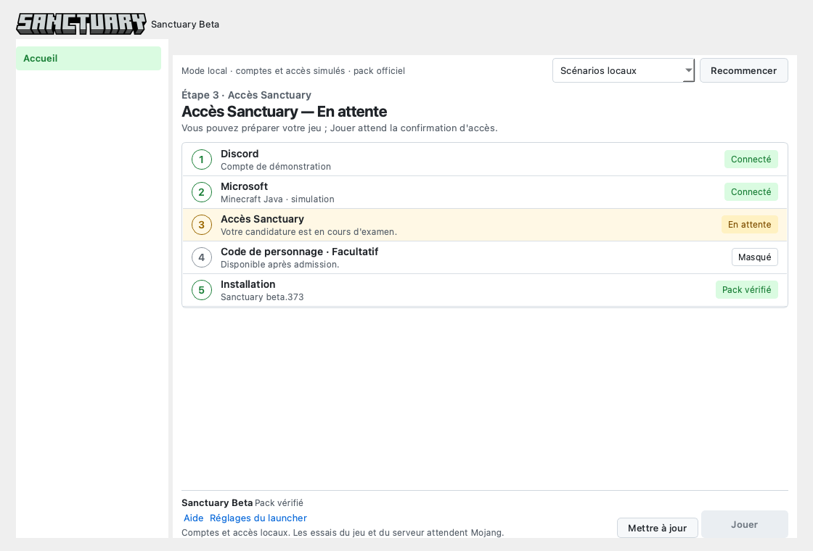
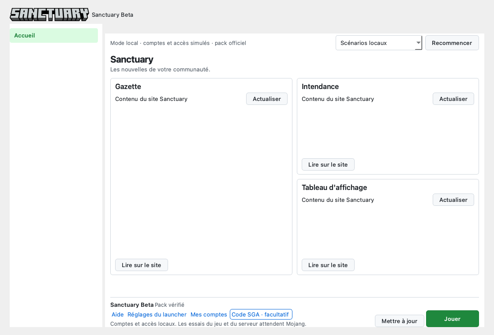

# Accueil fixe — recette du 8 novembre 2026

Ticket [LAUNCH-14](../tickets/LAUNCH-14-accueil-fixe.md), branche
`codex/launcher-fixed-home`, cahier des charges **0.6**.

## Disposition livrée

L'accueil ne contient plus de page défilante. Le header nomme l'étape en
cours, notamment l'attente d'accès. Le body utilise un `QStackedWidget` :
les cinq étapes sont remplacées en place par les panneaux communautaires
lorsque les prérequis sont réunis. La Gazette est à gauche, Intendance et
Tableau d'affichage sont empilés à droite.

Le footer reste au bas de la page : état/version du pack et liens à gauche,
installation/mise à jour puis **Jouer tout en bas à droite**. L'ouverture du
code SGA ne pousse pas ce footer hors écran. Le code reste facultatif.
L'ancien titre générique Accueil du conteneur est masqué sur cette page,
puisque son header présente déjà l'étape active.

Les rubriques communautaires utilisent des aperçus de texte bornés et une
ellipse selon l'espace disponible, sans navigateur de texte défilant.
**Lire sur le site** ouvre explicitement la rubrique correspondante, avec
sa langue et les permissions Discord habituelles. Le flux privé n'est pas
rendu public. L'onglet Actualités conserve séparément son historique défilant.

## Vérifications réelles

- Construction Release C++/Qt réussie sur macOS 26.5.1 arm64, Qt 6.12.0.
- **24 suites CTest réussies** avec le script de construction habituel.
- Dix scénarios, deux langues et trois tailles de fenêtre : **1000 × 680**,
  **1120 × 760**, **1280 × 800**. La fenêtre ne grandit pas pour faire tenir
  son contenu ; aucun défilement d'accueil ou chevauchement body/footer.
- Footer à position constante entre les scénarios ; Jouer reste son enfant
  ancré en bas à droite. Les cinq lignes restent entièrement dans le body.
- Même contrôle lorsque le code SGA facultatif est ouvert, avant et après
  préparation. Attente, refus et révocation conservent les barrières de Jouer.
- Le passage communauté → étapes est effectué par le conteneur empilé pour
  éviter qu'une visibilité temporaire des deux bodies agrandisse la fenêtre.
- `./script/build_and_run.sh --verify` reconstruit, teste et relance le
  profil local isolé ; processus de développement démarré après la recette.

## Rendus Qt contrôlés

Les images suivantes sont des rendus du `QMainWindow` de test à 1120 × 760,
avec uniquement Accueil dans sa navigation de test. L'application conserve
ses autres onglets. Il ne s'agit ni de nouvelles maquettes ni de captures
d'une session Microsoft/Discord ou d'un essai en jeu. Les panneaux sont vides
dans les tests sans réseau ; le launcher affiche la demande de session du
site lorsqu'un flux privé répond 401/403.

## Périmètre inchangé

Comptes et admission restent simulés localement. Microsoft/Mojang, session
Discord, personnage et connexion au serveur ne sont pas testés par ce lot.
Aucune nouvelle installation ou publication de pack, aucun changement du
canal Sanctuary Update, de Prism personnel, du site ou du serveur. Les essais
et empreintes du pack du lot précédent restent dans la
[recette d'installation](launcher-local-20261108.md).
