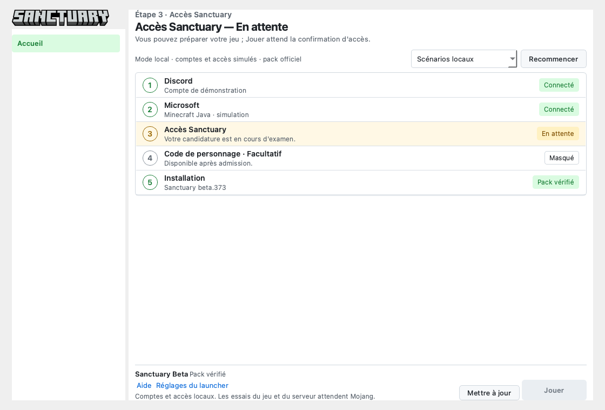
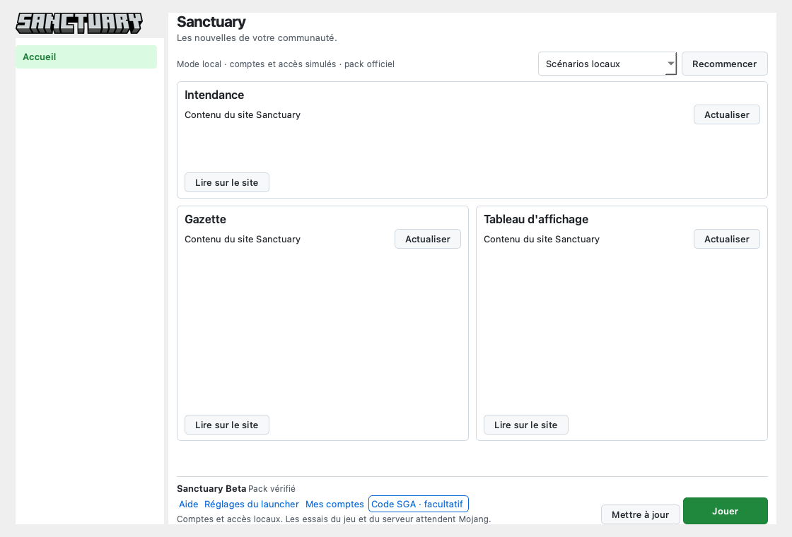

# Header intégré et panneaux réorganisés — 8 novembre 2026

Ticket [LAUNCH-15](../tickets/LAUNCH-15-header-integre.md), branche
`codex/launcher-header-layout`, cahier des charges **0.7**.

Le logo PNG est seul au sommet de la barre latérale. Le libellé Sanctuary
Beta à sa droite est supprimé. La colonne de contenu commence au même niveau
vertical que le logo : le header de l'étape active occupe cet espace, puis
le body suit directement. Les outils de développement locaux restent sous
le header. Les autres pages gardent leurs titres et commandes dans la même
colonne, y compris les réglages globaux.

Dans le body communautaire, **Intendance** occupe toute la largeur en haut.
**Gazette** et **Tableau d'affichage** sont en dessous, respectivement à gauche
et à droite. Le footer reste ancré avec Jouer en bas à droite, sans défilement.
La version du pack reste dans ce footer.

## Vérifications

Construction locale Release réussie et **24 suites CTest réussies**.
Les dix scénarios FR/EN sont vérifiés à 1000 × 680, 1120 × 760 et 1280 × 800,
avec et sans code SGA ouvert. Le contrôle de géométrie vérifie l'alignement
vertical logo/header, l'Intendance au-dessus des deux autres panneaux et sa
largeur commune, la Gazette à gauche du Tableau, ainsi que le footer visible
et fixe. Les tests existants de navigation et de formulaires passent.

`./script/build_and_run.sh --verify` a reconstruit, testé et relancé le profil
local isolé. Aucun lancement de Minecraft, authentification réelle, publication
de pack, déploiement du site/serveur ou modification de Prism personnel.

## Rendus contrôlés

Rendus Qt du `QMainWindow` de test à 1120 × 760. Sa navigation de test contient
seulement Accueil ; les autres onglets sont conservés dans l'application.
Les panneaux sont vides dans les tests sans réseau. Ces images ne constituent
ni des maquettes générées ni une preuve de session Discord/Microsoft.

Les limites de comptes et de contenus privés du
[lot local](launcher-local-20261108.md) restent ouvertes. La
[recette précédente](accueil-fixe-20261108.md) est conservée pour l'historique.
