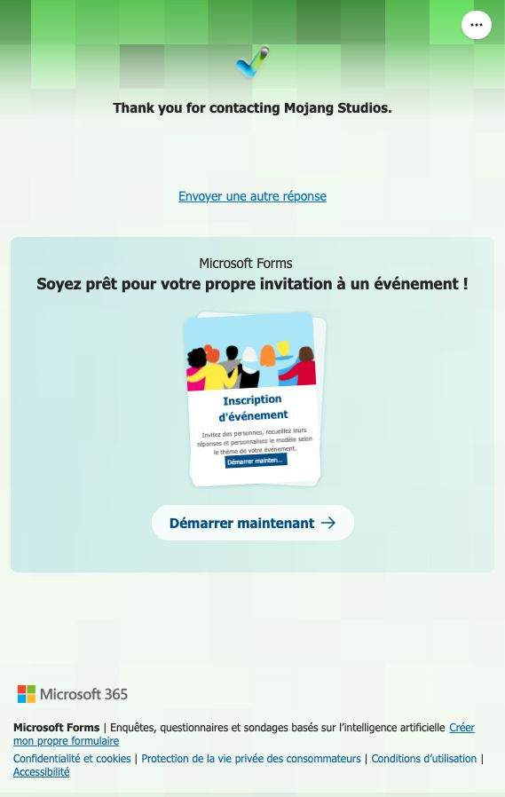

# Application Microsoft Sanctuary Launcher

L'application **Sanctuary Launcher** a été créée et vérifiée dans Microsoft
Entra le **8 novembre 2026**, après la création du compte Azure et de son
annuaire. La demande d'accès Minecraft a été envoyée le même jour à la demande
de Koka. Microsoft Forms confirme sa réception ; l'autorisation est en attente
et les essais réels restent à faire.

## Configuration enregistrée

| Propriété | Valeur |
| --- | --- |
| Nom d'affichage | Sanctuary Launcher |
| Application (Client) ID | `8e8a2428-a727-4668-98ea-2fdaf0037943` |
| Directory (Tenant) ID | `68f8c41e-0b91-4c87-b7e5-ee08bef299ee` |
| Comptes pris en charge | Comptes Microsoft personnels uniquement |
| Autoriser les flux clients publics | Activé et enregistré |
| URI de redirection | Aucun à ce stade : le parcours préparé est le code de périphérique |
| Secret client | Aucun créé |
| Intégration au binaire | Non activée ; `Launcher_MSA_CLIENT_ID` reste vide |
| Demande AppID Minecraft | Envoyée le 8 novembre 2026 ; réception confirmée, décision en attente |

Les deux identifiants ci-dessus ne sont pas des secrets d'authentification.
Aucun mot de passe, code de vérification, jeton, adresse personnelle, numéro
de téléphone, donnée bancaire ou session du compte d'administration n'est
conservé dans le dépôt. La preuve visuelle de création reste locale.

Prism 11.1.1 utilise le flux de code de périphérique sur le point de terminaison
Microsoft `consumers` dans `launcher/minecraft/auth/steps/MSADeviceCodeStep.cpp`.
Ce choix de comptes correspond à ce parcours. Les vérifications de session,
de possession du jeu et de profil Minecraft doivent rester celles du moteur
Prism lors de son raccordement ; l'inscription seule ne les valide pas.

## Demande d'accès Minecraft envoyée

Le [formulaire officiel AppID Review](https://aka.ms/mce-reviewappid)
a été soumis le **8 novembre 2026**. Les identifiants et le nom ont été
vérifiés dans le portail Azure avant l'envoi. L'EULA et les règles d'utilisation
ont été consultées avant de confirmer leur lecture dans le formulaire.

Informations transmises :

- Type : `New AppID for Approval`.
- Application : `Sanctuary Launcher`, identifiants du tableau ci-dessus.
- Site : `https://sanctuary-minecraft.net/`.
- Contact : adresse du compte d'administration Azure, saisie uniquement dans
  le formulaire Microsoft ; aucune adresse personnelle dans Git.

Justification envoyée :

> Sanctuary Launcher is a desktop launcher dedicated to the Sanctuary modpack
> and server, built as an independent fork of Prism Launcher 11.1.1. We request
> access to the Minecraft authentication and services APIs so players can sign
> in with their personal Microsoft accounts, verify Minecraft Java ownership
> and their game profile, install the modpack, and join our server. The launcher
> will retain Prism's authentication and ownership checks and will require a
> valid session and game entitlement before enabling gameplay.

Informations complémentaires envoyées :

> The launcher is currently in development. Microsoft public-client device-code
> authentication is configured in Entra, without a client secret. We are
> requesting AppID review before enabling production sign-in. Sanctuary Launcher
> is an independent community project and is not an official Minecraft product
> or associated with Mojang or Microsoft.

La page de confirmation affiche **« Thank you for contacting Mojang Studios. »**.
Elle ne fournit pas de numéro de dossier. La
[capture du reçu](receipts/minecraft-appid-review-20261108.jpg) est conservée
sans données de contact. Aucun second envoi n'a été effectué.

Le formulaire indique un examen hebdomadaire et précise qu'un envoi répété
n'accélère pas la procédure. Ce n'est pas une garantie de délai ou d'acceptation.
Après autorisation, raccorder le Client ID au fork, vérifier les erreurs et
annulations de connexion, puis tester le parcours avec un compte possédant le
jeu. La préparation du pack et de l'accueil peut continuer entre-temps.

Références : [enregistrement Entra](https://learn.microsoft.com/en-us/entra/identity-platform/quickstart-register-app),
[compte personnel sans annuaire](https://learn.microsoft.com/en-us/troubleshoot/entra/entra-id/app-integration/error-code-AADSTS50020-user-account-identity-provider-does-not-exist#solution-create-an-azure-account-with-a-new-tenant),
[AppID Review](https://aka.ms/mce-reviewappid).
